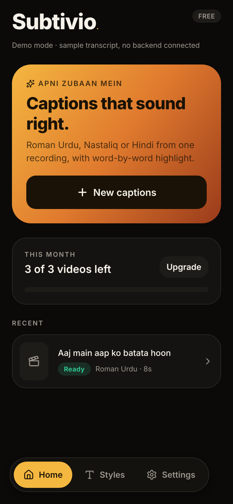
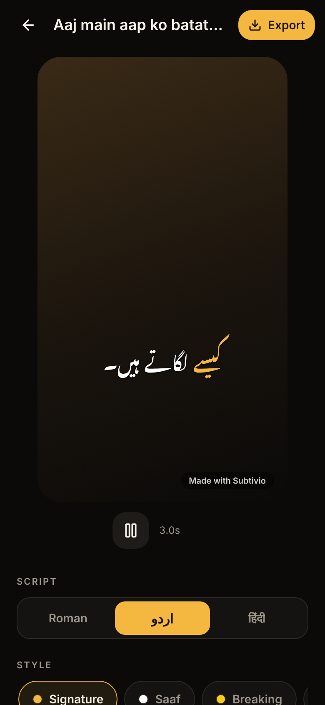
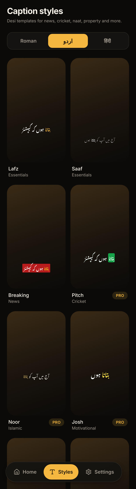
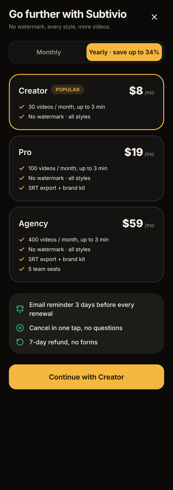

# Subtivio

AI captions for reels in **Roman Urdu, Urdu (Nastaliq) and Hindi**, from one recording with word-by-word highlight.
Built with Expo (iOS · Android · Web), NativeWind and Supabase.

<p>
  
  
  
  
</p>

## Quick start

```bash
pnpm install
pnpm web          # open in the browser
pnpm dev          # Expo dev server (press i / a for simulators)
pnpm check        # typecheck + lint + tests
```

Without `apps/mobile/.env.local` the app runs in **demo mode** with a sample transcript. Copy `.env.example` to connect Supabase.

**On your Android phone (local build, no Expo cloud):** needs Android Studio / Android SDK and JDK 17, and the phone connected by USB with USB debugging on.

| Command | What it does |
|---|---|
| `pnpm android` | Builds the debug app, installs it on the phone and starts the dev server. Saved code changes appear live. Run it again only after adding a native package. |
| `pnpm dev` | Starts the dev server only, once the debug app is already installed. |
| `pnpm build:apk` | Builds a standalone release APK (no dev server needed) to share with testers. |
| `pnpm install:apk` | Installs that release APK on the USB-connected phone. |

## Layout

| Path | What |
|---|---|
| `apps/mobile` | Expo Router app: screens, design system, features |
| `packages/core` | Shared caption logic: scripts, transcript, line grouping, templates, editing, SRT, plans (tested) |
| `supabase/migrations` | Postgres schema with row-level security |
| `docs/ARCHITECTURE.md` | System design, tech choices, build phases |
| `docs/COMPETITORS-2026-10.md` | Competitor re-check (Oct 2026) |
